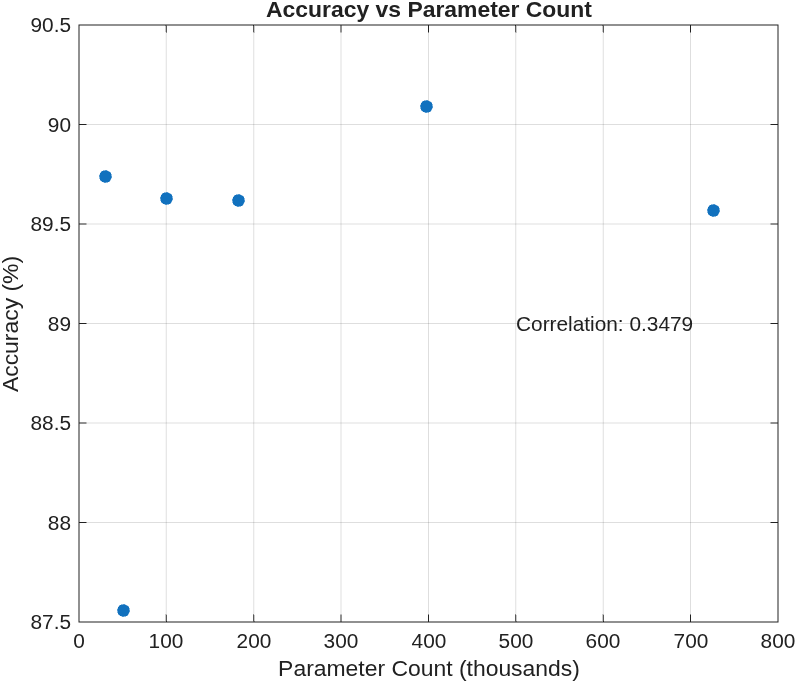
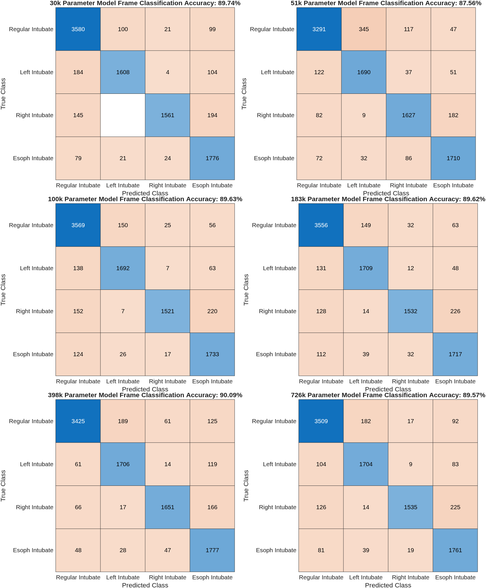
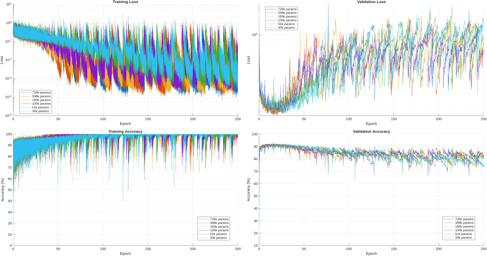
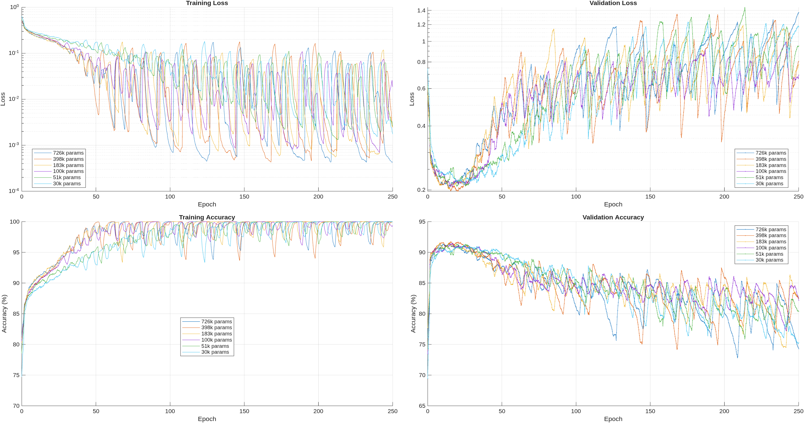
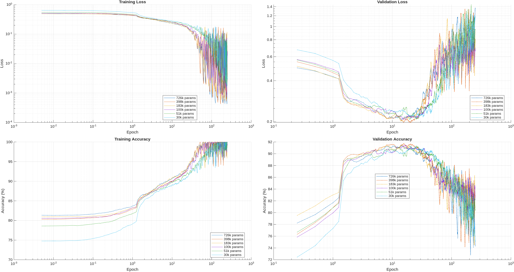
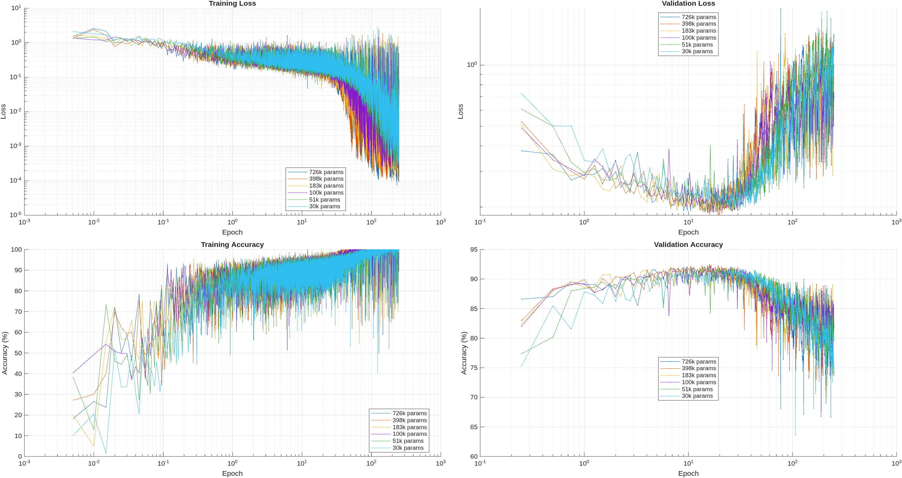
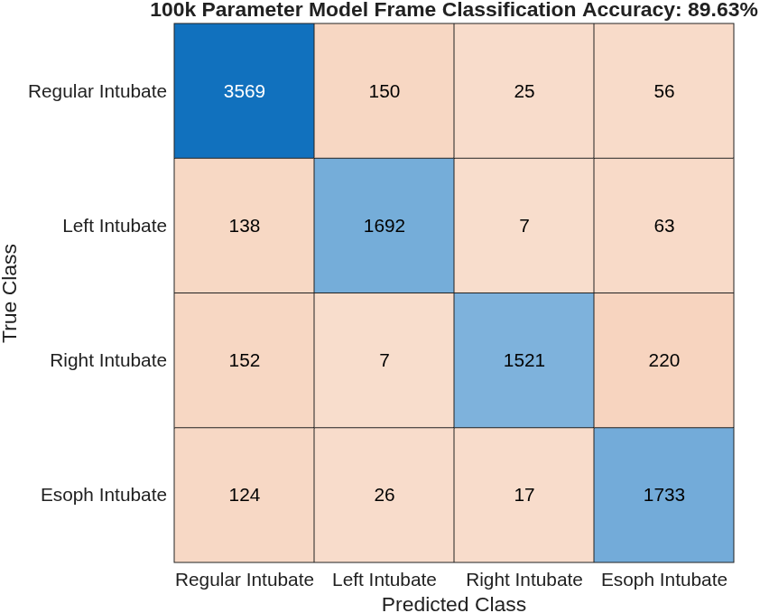
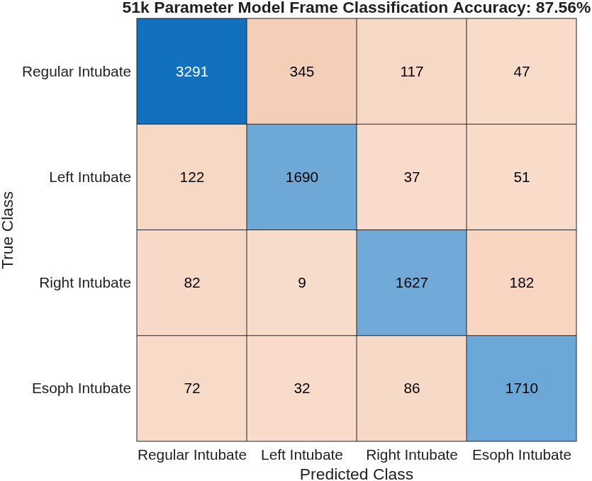
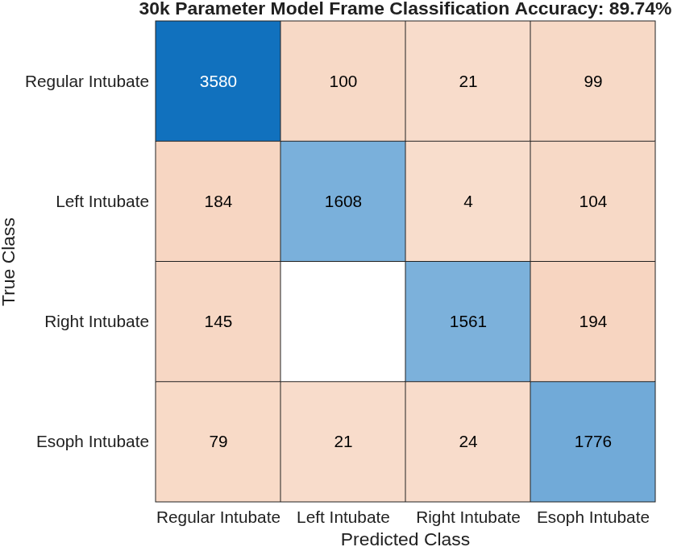

<!-- pandoc -H img_fix.tex --from=markdown+table_captions -N -V geometry:"top=3cm,bottom=3cm,left=3cm,right=3cm" JonahSpector_Report_2026_09_27.md -o JonahSpector_Report_2026_09_27.pdf -->

# 3D CNN-LSTM Architecture Preliminary Results

The the six models trained and tested in this report use 3D CNN-LSTM
architectures with varying parameter counts. All conductivity videos were
converted to difference images using the first frame at peak exhalation
(inhalation?) as reference. Overall, there was little correlation between
parameter count and accuracy, so smaller 3D CNN-LSTM architectures may be more
practical. A refined version of the 30k parameter model, with better tuned
hyperparameters may have a higher accuracy. All models had test accuracies of
around 90%. The models all have a `SSSCBT` input and `CBT` output (MATLAB
`dlarray` format), with LSTMs in sequence-to-sequence mode.

I did not get a chance to use contiguous subsequences since they will require
on-the-fly transformations of the minibatchqueue/datastore tensors that I am not
sure how to implement yet. (Otherwise, the datastores would need something a few
hundred terabytes to store all the permutations.) The example prediction below,
performed on a video from the test data, shows why I still think it might be
useful:


| Regular Intubation  Frame Predictions    |      |           |           |           |
|-------------------------------------------------|-----------|-----------|-----------|-----------|
| Frame #                                         | 1         | 2         | 3         | 4         |
| Regular                                         | 0.3217086 | 0.5462505 | 0.490133  | 0.4860978 |
|                 Left                                            | 0.2689573 | 0.2091847 | 0.1731991 | 0.0764423 |
|                 Right                                           | 0.1589836 | 0.1327215 | 0.1786893 | 0.3360106 |
|                 Esoph                                           | 0.2503504 | 0.1118432 | 0.1579786 | 0.1014492 |
| Frame #                                         | 5         | 6         | 7         | 8         |
| Regular                                         | 0.7821677 | 0.9491044 | 0.9915    | 0.9953353 |
|                 Left                                            | 0.0832151 | 0.0283647 | 0.006785  | 0.0041113 |
|                 Right                                           | 0.0991742 | 0.0212553 | 0.0016717 | 0.0005425 |
|                 Esoph                                           | 0.035443  | 0.0012755 | 0.0000432 | 0.0000111 |
| Frame #                                         | 9         | 10        | 11        | 12        |
| Regular                                         | 0.9991885 | 0.999738  | 0.9997987 | 0.9998353 |
|                 Left                                            | 0.0007169 | 0.0002394 | 0.0001763 | 0.0001524 |
|                 Right                                           | 0.0000927 | 0.000022  | 0.0000245 | 0.000012  |
|                 Esoph                                           | 0.0000019 | 0.0000005 | 0.0000004 | 0.0000002 |

The first few frames show low probabilities for regular intubation because the
LSTM can yet find patterns emerging over time. Giving the model more training
examples with a limited number of frames, especially early on, may help fix
this. It might also be worth running tests on longer, multi-breath videos to
ensure the model doesn't break after one breath.

Each subject (n=106) has 25 conductivity videos, with 40% showing regular
intubation, and 10% each for esophageal, left lung, and right lung intubation.
The conductivity video data used, split by subject had training (n=2000),
validation (n=400), test (n=250) partitions. Each with approximately 75%, 15%,
and 10% of the subjects, respectively.

Some remaining things of note:

* 'conv3d1' may perform better with a [1 1 2] stride instead of [2 2 2].
  Regardless, its 6x6 filters convolve over both layers of the image (6x6x2).
* Each convolution is followed by a batchnorm and leakyReLu, which may have
  better alternatives I don't know of.
* 'gmpool3d' might be causing issues between the the CNN and LSTM sections. I
  don't have enough intuition or knowledge to know for sure.

# Architecture

**726k parameter model (all convolution padding is 'same'):**

```
 1   'sequence'     Sequence Input           Sequence input with size 48×48×2×1
 2   'conv3d1'      3-D Convolution          32 6×6×2×1 convolutions with stride [2  2  2]
 3   'batchnorm1'   Batch Normalization      Batch normalization with 32 channels
 4   'leakyrelu1'   Leaky ReLU               Leaky ReLU with scale 0.01
 5   'maxpool3d1'   3-D Max Pooling          2×2×1 max pooling with stride [2  2  1]
 6   'conv3d2'      3-D Convolution          64 4×4×1×32 convolutions with stride [1  1  1]
 7   'batchnorm2'   Batch Normalization      Batch normalization with 64 channels
 8   'leakyrelu2'   Leaky ReLU               Leaky ReLU with scale 0.01
 9   'maxpool3d2'   3-D Max Pooling          2×2×1 max pooling with stride [2  2  1]
10   'conv3d3'      3-D Convolution          128 2×2×1×64 convolutions with stride [1  1  1]
11   'batchnorm3'   Batch Normalization      Batch normalization with 128 channels
12   'leakyrelu3'   Leaky ReLU               Leaky ReLU with scale 0.01
13   'conv3d4'      3-D Convolution          256 2×2×1×128 convolutions with stride [2  2  1]
14   'batchnorm4'   Batch Normalization      Batch normalization with 256 channels
15   'leakyrelu4'   Leaky ReLU               Leaky ReLU with scale 0.01
16   'gmpool3d'     3-D Global Max Pooling   3-D global max pooling
17   'flatten'      Flatten                  Flatten
18   'lstm'         LSTM                     LSTM with 256 hidden units
19   'fc'           Fully Connected          Fully connected layer with output size 4
20   'softmax'      Softmax                  Softmax
```

**398k parameter model (only changes from previous architecture shown):**

```
18   'lstm'         LSTM                     LSTM with 128 hidden units
```

**183k parameter model (only changes from previous architecture shown):**

```
 2   'conv3d1'      3-D Convolution          16 6×6×2×1 convolutions with stride [2  2  2]
 6   'conv3d2'      3-D Convolution          32 4×4×1×16 convolutions with stride [1  1  1]
10   'conv3d3'      3-D Convolution          64 2×2×1×32 convolutions with stride [1  1  1]
13   'conv3d4'      3-D Convolution          128 2×2×1×64 convolutions with stride [2  2  1]
```

The number of filters for each convolution layer was halved.

**100k parameter model (only changes from previous architecture shown):**

```
18   'lstm'         LSTM                     LSTM with 64 hidden units
```

**51k parameter model (only changes from previous architecture shown):**

```
10   'conv3d3'      3-D Convolution          64 2×2×1×32 convolutions with stride [1  1  1]
11   'batchnorm3'   Batch Normalization      Batch normalization with 64 channels
12   'leakyrelu3'   Leaky ReLU               Leaky ReLU with scale 0.01
13   'gmpool3d'     3-D Global Max Pooling   3-D global max pooling
14   'flatten'      Flatten                  Flatten
```

The fourth convolution layer, with 128 filters, was removed.

**30k parameter model (only changes from previous architecture shown):**

```
15   'lstm'         LSTM                     LSTM with 32 hidden units
```

# Test Accuracy and Confusion Charts for Test Partition

It is clear that the data do not require models with higher parameter counts,
and are easily separable. The same might not be true for absolute imaging or raw
voltages.

{ width=50% }


**Comments on training curves:** Note how the loss on the log plot has a steep
drop after around 40-50 epochs. This is when the validation loss starts to
increase, likely because of overfitting. Only the model with the highest
validation is returned by MATLAB, which seems to be before the overfitting. The
noise in the training can be reduced by increasing the minibatch size from 10 to
some larger value and possibly by reducing the size of the model to be trained.
It might be worth reducing the learning rate or changing other `trainingOptions`
too. Training for more than 100 epochs doesn't seem useful.

\newpage



\newpage

# Training Curves









<!-- # Confusion Charts






 -->